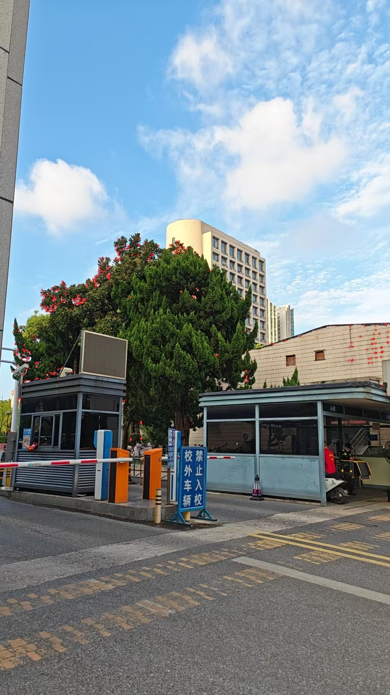
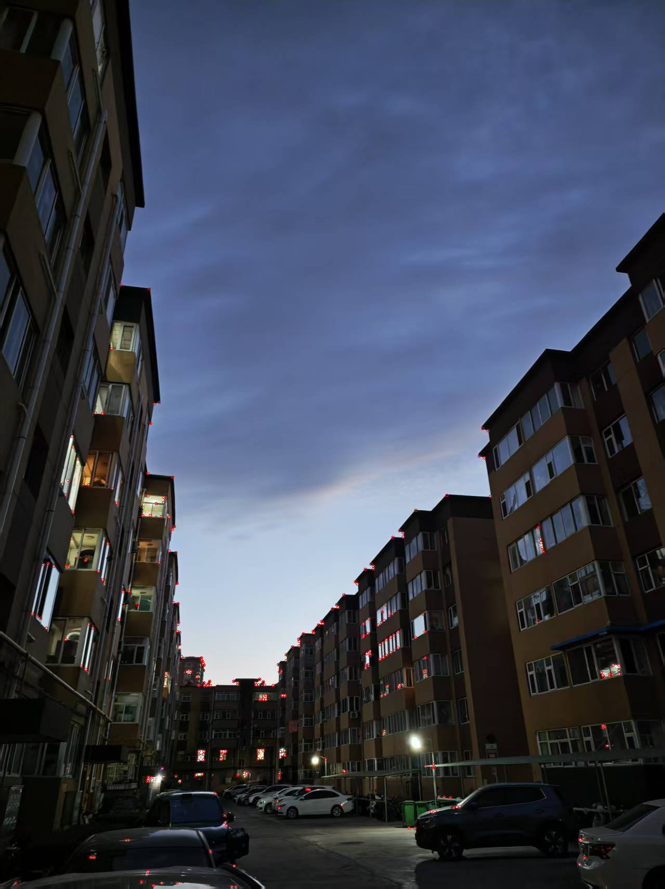

# Moravec and Harris

用 C++ 和 OpenCV 实现的两个经典角点检测算法。主要检测步骤在源码中展开，没有直接调用 `cv::cornerHarris` 等现成的角点检测接口，适合配合原理学习和观察中间结果。

- **Moravec**：比较窗口沿八个位移方向移动前后的灰度差平方和，取最小值作为响应。
- **Harris**：计算图像梯度，构建结构张量，再通过 Harris 响应筛选角点。

两份代码是独立的学习实现，保留了原始注释。

## 示例

### Moravec



### Harris



红圈标出了检测到的位置。两张示例使用不同输入，仅展示各自的运行效果，不用于比较算法优劣。树叶、文字等复杂纹理同样可能产生角点响应，并不只有建筑物的几何拐角会被选中。

## 文件结构

```text
.
├── README.md
├── .gitignore
├── Moravec/
│   ├── Moravec.cpp
│   └── img1.jpg          # Moravec 默认输入
├── Harris/
│   ├── Harris.cpp
│   └── img.jpg           # Harris 默认输入
└── examples/
    ├── moravec1.jpg      # 已有示例结果
    └── Harris.png
```

## 编译与运行

### 依赖

- 支持 C++17 的编译器
- OpenCV 4 开发环境
- `pkg-config`

Ubuntu / Debian 可以安装：

```bash
sudo apt update
sudo apt install build-essential pkg-config libopencv-dev
```

确认 OpenCV 可用：

```bash
pkg-config --modversion opencv4
```

### 获取代码并编译

```bash
git clone https://github.com/Teddy28-dron/Moravec-and-Harris.git
cd Moravec-and-Harris
mkdir -p build

g++ -std=c++17 Moravec/Moravec.cpp -o build/moravec $(pkg-config --cflags --libs opencv4)
g++ -std=c++17 Harris/Harris.cpp -o build/harris $(pkg-config --cflags --libs opencv4)
```

两个源文件各自包含 `main`，应分别编译，不要一起链接成一个程序。

### 运行 Moravec

从仓库根目录执行：

```bash
(cd Moravec && ../build/moravec)
```

程序读取 `Moravec/img1.jpg`，并在 `Moravec/` 中输出：

| 文件 | 内容 |
| --- | --- |
| `moravec1.jpg` | 绘制了角点的彩色图 |
| `keymap.jpg` | 阈值筛选前的响应可视化 |
| `keymap_th.jpg` | 阈值筛选后的响应可视化 |

### 运行 Harris

同样从仓库根目录执行：

```bash
(cd Harris && ../build/harris)
```

程序读取 `Harris/img.jpg`，输出 `Harris/Harris.png`。

**图片路径相对于运行时的工作目录，不是相对于可执行文件。**代码目前不解析命令行参数；更换输入时，可以替换对应图片，或修改各自 `main` 中的路径。再次运行会覆盖同名输出，不会改动 `examples/` 中保存的示例。

## 实现流程与参数

### Moravec

```text
灰度图 → 八个位移的窗口差异 → 取最小响应
       → 阈值筛选 → 非极大值抑制 → 按分数限量 → 绘制
```

主函数调用：

```cpp
auto [corners, result] = getMoravecKps("img1.jpg", 3, 1, 5, 0, 300, -1);
```

| 参数 | 当前值 | 说明 |
| --- | --- | --- |
| `img_path` | `"img1.jpg"` | 输入图片路径 |
| `win_size` | `3` | 比较窗口大小，需为正奇数 |
| `win_offset` | `1` | 水平、垂直位移分量的步长 |
| `nonMaxSize` | `5` | 非极大值抑制窗口大小，需为正奇数 |
| `nonMaxValue` | `0` | 非极大值的填充值，当前流程建议保持为零 |
| `nFeature` | `300` | 最多保留的点数，`-1` 表示不限制 |
| `thCRF` | `-1` | 自动使用整张响应图均值，否则使用指定阈值 |

函数返回关键点列表和绘制结果。每个关键点包含 `x`、`y`、`score`。

窗口差异为：

$$
E(u,v)=\sum_{(x,y)\in W}[I(x+u,y+v)-I(x,y)]^2
$$

响应取八个位移差异的最小值。源码中“八个方向上的梯度的平方和”的注释不够准确，实际计算的是**窗口灰度差的平方和**。

### Harris

```text
灰度图 → 高斯平滑 → Sobel 梯度 → 梯度乘积
       → 高斯加权汇总 → Harris 响应
       → 正响应筛选 → 非极大值抑制 → 按分数限量 → 绘制
```

结构张量与响应为：

$$
M=\begin{bmatrix}A&C\\C&B\end{bmatrix},\qquad
R=AB-C^2-k(A+B)^2
$$

其中，三个元素是邻域内梯度平方、交叉乘积的高斯加权和。

当前实现的参数分布在函数默认值及 `main` 中：

- 高斯平滑默认 `sigma = 1.0`，对应 7×7 核；预平滑和梯度乘积汇总均使用这个默认值。
- Sobel 核大小为 3，梯度保存为 `CV_32F`。
- Harris 系数固定为 `k = 0.04`。
- 非极大值抑制窗口默认 5×5。
- 先去除非正响应，再筛选，最多保留 300 个点。

## 已知限制

- 未完善处理读图失败、非法参数等情况，请先确认输入文件存在。
- Moravec 的边界范围没有独立结合非极大值抑制窗口计算。默认参数可运行，增大抑制窗口前应检查是否越界。
- 两份代码的局部极大值判断都使用 `>=`，并列最大值可能保留多个点，不保证最小点间距。
- 阈值策略较简单：Moravec 的自动均值包含未计算、保持为零的边界；Harris 没有额外的强正响应阈值。
- `getkeypoints` 打印的是截取前的候选数量；默认最终最多保留 300 点。
- Moravec 直接把浮点响应写入 JPEG，OpenCV 会回退到 8 位，可能提示 `Unsupported depth ... fallbacked to CV_8U`。高值可能饱和，不能凭这两张响应图直接比较数值大小；需要定量分析时应保存浮点数据，展示时应先做适当映射。
- 绘制函数对 `cv::Mat` 使用浅拷贝，因此也会修改传入图像的数据。
- 没有实现尺度选择、亚像素定位、特征描述或匹配，也没有做系统的检测性能评测。

## 参考

Moravec 源码参考了赵旭辉的文章：[Moravec 角点检测](https://zhaoxuhui.top/blog/2019/01/10/MoravecCornerDetection.html)。保留原代码的参考说明，感谢作者的分享。
